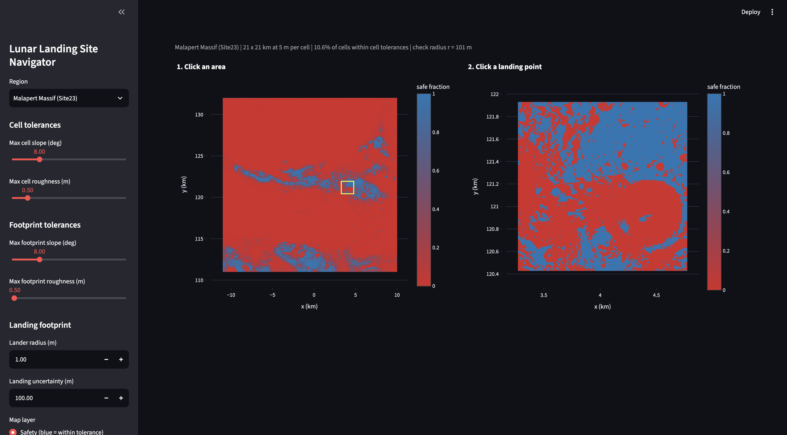
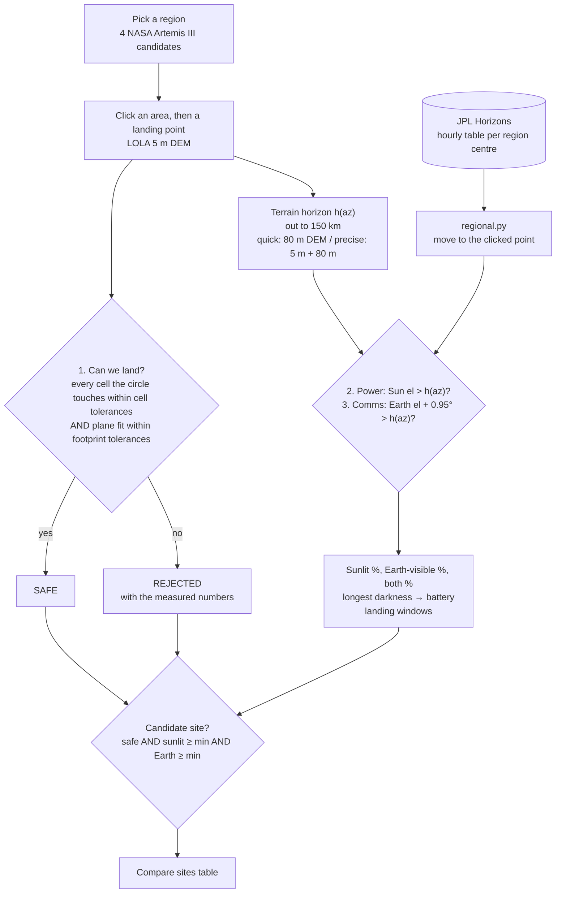
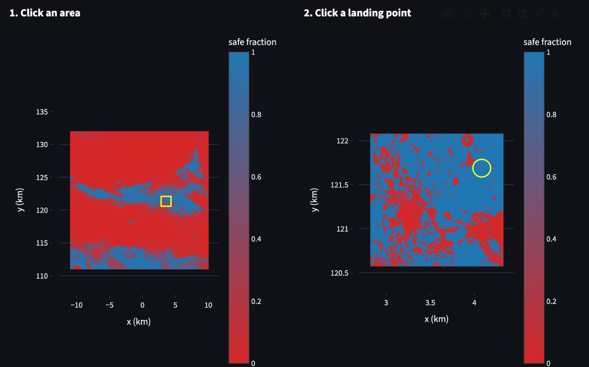
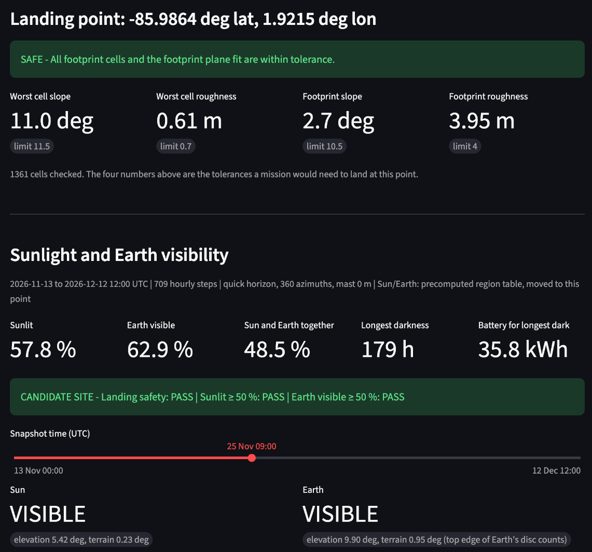
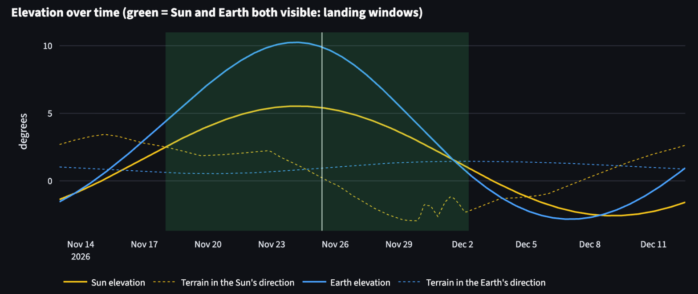
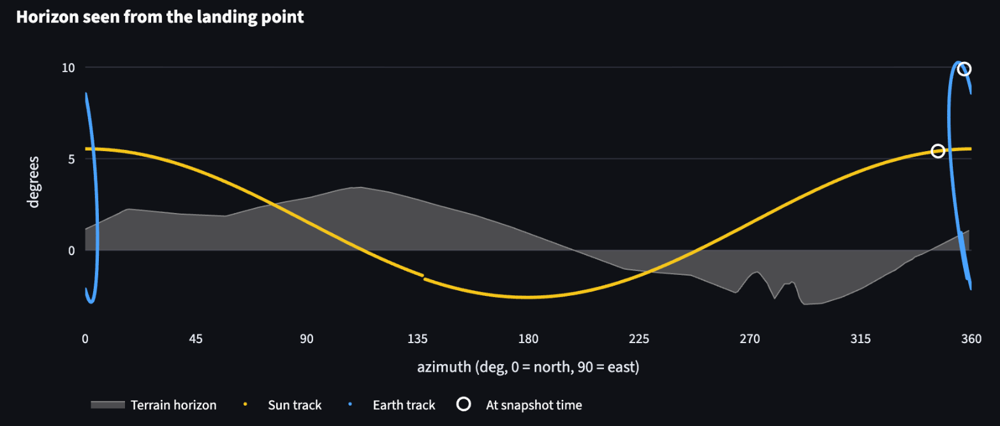
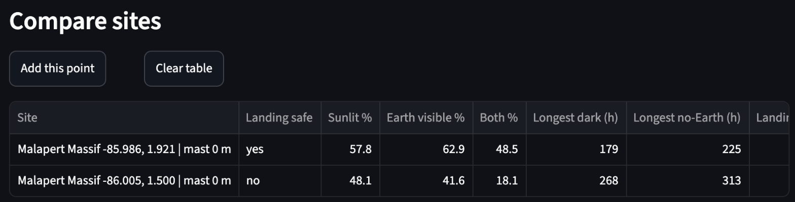

# Lunar Landing Site Navigator

NASA Space Apps Challenge 2026 — *Lunar Landing Site Navigator*
Team Stelantis: Varun, Kavin, Guru Prashanth, Rehaan

Pick a point near the lunar south pole and the tool answers three questions:

1. **Can we land here?** Slope and roughness of every 5 m cell inside the landing
   circle (lander radius + landing uncertainty), plus a plane fitted to the whole
   circle. All four tolerances are set by the user, and the tool reports what the
   spot actually measures — i.e. the tolerances a mission would need to land there.
2. **Will it have power?** Terrain horizon in every direction, then hour by hour
   whether the Sun is above it (JPL Horizons positions).
3. **Can it talk to Earth?** The same test for Earth.

Output: sunlit %, Earth-visible %, both together, longest darkness (and the battery
it needs), landing windows (Sun and Earth both up), and a table comparing points.



## How it works



## Screenshots

| | |
|---|---|
|  |  |
| Safety maps: blue = within tolerance, red = outside | Verdict: SAFE, sunlit %, Earth %, battery; Sun and Earth both visible on 25 Nov |
|  |  |
| Sun and Earth vs the terrain; green = landing window | Horizon from the landing point, with the Sun and Earth tracks |



All screenshots show the example spot below (Malapert, −85.9864°, 1.9215°).

## Run it

```
pip3 install -r requirements.txt
python3 -m streamlit run main.py
```

That is all you need: the repo includes compressed DEMs in `data/packed/` and the
precomputed Sun/Earth tables in `cache/CENTRE_*.csv`, so the app runs offline.

Optional:

- `python3 setup_data.py` downloads the full NASA DEMs into `data/raw/` (~500 MB);
  the app uses them instead of `data/packed/` when present. Needed for `validate.py`.
- `python3 precompute.py` rebuilds the Sun/Earth tables (needs internet to JPL).
  They cover 1 Nov 2026 – 31 Dec 2027; for other dates, change `T0` / `T1` in
  `precompute.py` and re-run it.
- The sidebar's **Clear all** button deletes `cache/`, including those tables;
  after that the app needs internet to rebuild them.

## Data (all open NASA data)

| Use | Product | Files |
|---|---|---|
| Landing safety, near-field horizon (5 m) | [PGDA product 78](https://pgda.gsfc.nasa.gov/products/78) — LOLA 5 m south pole site DEMs | `Site23`, `Haworth`, `Site06`, `Site11` `_final_adj_5mpp_surf.tif` |
| Horizon, far field (80 m) | [PGDA product 90](https://pgda.gsfc.nasa.gov/products/90) — Barker et al. 2023 | `LDEM_80S_80MPP_ADJ.TIF` |
| Sun and Earth positions | [JPL Horizons API](https://ssd-api.jpl.nasa.gov/doc/horizons.html) | one hourly table per region centre, `cache/CENTRE_*.csv` |
| Validation: slope | PGDA product 78 | `*_final_adj_5mpp_slp.tif` |
| Validation: sunlight, Earth visibility | [PGDA product 69](https://pgda.gsfc.nasa.gov/products/69) — Mazarico et al. 2011 | `AVGVISIB_85S_060M_201608*.TIF` |

Regions are NASA Artemis III candidate regions that have a 5 m DEM: Malapert Massif,
Haworth, Nobile Rim 1, de Gerlache Rim.

## Method

Symbols: R = Moon radius 1 737 400 m; D = DEM cell size (m); z = height (m);
d = horizontal distance (m); az = azimuth (deg from north); el = elevation (deg).

- **Slope** per cell: `atan( sqrt((dz/dx)^2 + (dz/dy)^2) )`, central differences.
- **Roughness** per cell: largest |z − plane| in a 3 × 3 window after a least-squares
  plane fit.
- **Landing check:** every cell the circle touches must be within the cell
  tolerances, and the plane fitted to the whole circle (`AᵀA p = Aᵀz`) within the
  footprint tolerances.
- **Horizon:** `h(az) = max over d of atan( (z(d) − z_site − h_mast − d²/2R) / d )`,
  out to 150 km, all 360 azimuths at once. *Quick* mode uses the 80 m DEM only;
  *precise* mode uses the 5 m DEM wherever the ray is inside it.
- **Sun / Earth at any point:** the Sun and Earth point the same way in space from
  every spot in a 20–30 km region; only the local up/north/east frame changes. So
  `regional.py` turns the region centre's az/el into a direction vector and
  re-expresses it in the clicked point's frame.
- **Visible:** the Sun when `el > h(az)`. Earth when `el + ρ > h(az)`, where
  ρ = Earth's angular radius seen from the Moon = asin(6.371e6 m / 3.844e8 m) ≈ 0.95°.
  This matches NASA's rule (PGDA product 69): Earth counts as visible if any part
  of its disc is unobscured.
- **Battery:** E = P_load × t_dark, where P_load = power drawn while dark (W) and
  t_dark = longest continuous darkness (h); E in Wh.

## Validation

**Slope vs NASA's own slope maps** (every cell of each region):

| Region | Cells | Median difference | 95th percentile | Agree on < 8° |
|---|---|---|---|---|
| Malapert Massif | 17.6 M | 0.000° | 0.002° | 100.00 % |
| Haworth | 35.5 M | 0.000° | 0.007° | 99.97 % |
| Nobile Rim 1 | 16.0 M | 0.001° | 0.002° | 100.00 % |
| de Gerlache Rim | 10.2 M | 0.000° | 0.000° | 100.00 % |

Both maps come from the same LOLA heights, so this shows our processing reproduces
NASA's; real-world accuracy is limited by the map itself (slope error 1.5–2.5°).

**Horizon maths vs exact 3D geometry:** within 0.017°.
**Horizons link:** Sun azimuth drifts −0.507°/h (expected −0.508°/h for one lunar day).

**Region table moved to a point vs live Horizons there** (Malapert, 6.2 km from the
centre, 721 hours): Sun az/el within 0.0001°, Earth az within 0.001°, Earth el within
0.0001°; Sun- and Earth-visible flags agree 100 % of hours. Without the frame
correction, Sun elevation would be off by up to 0.205°.

**Sunlight and Earth visibility vs NASA's average maps** (PGDA product 69; 36 points
per region; quick horizon; our window 1 Nov 2026 – 31 Dec 2027):

| Region | Sunlit %: ours / NASA | Earth-visible %: ours / NASA | Correlation (sun / Earth) |
|---|---|---|---|
| Malapert Massif | 35.3 / 34.6 | 49.0 / 48.6 | 0.971 / 1.000 |
| Haworth | 23.5 / 23.8 | 35.6 / 38.9 | 0.991 / 0.972 |
| Nobile Rim 1 | 29.2 / 29.5 | 21.7 / 22.3 | 0.983 / 0.983 |
| de Gerlache Rim | 28.5 / 28.2 | 30.5 / 31.7 | 0.986 / 0.999 |

All regions, sunlight: correlation 0.984 over 144 points. Shadow check: the one test
point we find at 0 % sunlight is also 0 % in NASA's map. NASA averages over 18.6
years and we cover about 14 months, which likely explains most of what remains
(largest at Haworth).

## Example result

Malapert, −85.9864°, 1.9215°; 13 Nov – 12 Dec 2026; quick horizon; tolerances
cell 11.5° / 0.7 m, footprint 10.5° / 4.0 m: **safe**, sunlit 57.8 %, Earth visible
62.9 %, both 48.5 %, longest darkness 179 h → 35.8 kWh battery at 200 W, landing
window 18 Nov 00:00 – 2 Dec 07:00 UTC.

At NASA's 8° limit with a 100 m circle, none of 10 000 test spots in the Malapert
tile passes; at 20° / 1.5 m cell and 20° / 12 m footprint, 1 091 do.

## Defaults (all user-editable)

| Setting | Default | Basis |
|---|---|---|
| Max cell slope / footprint slope | 8° | NASA's landed-tilt limit for crew operations (NASA OIG, 2026) |
| Max cell / footprint roughness | 0.5 m | placeholder for lander ground clearance |
| Lander radius | 1 m | — |
| Landing uncertainty | 100 m | NASA Artemis III landing site ≈ 100 m radius |
| Mast height | 0 m | slider 0–10 m |
| Window | 29.5 days, hourly | one lunar day |
| Min sunlit / Earth-visible | 50 % / 50 % | placeholder |
| Power draw while dark | 200 W | placeholder |

## Limitations

1. Hazards smaller than a DEM cell (boulders, craters < 5–10 m) are invisible.
2. The Sun is treated as a point, not a 0.53° disc — no partial-shadow hours.
   (Earth is treated as a disc, see Method.)
3. Earth above the horizon is necessary but not sufficient for comms: Deep Space
   Network station availability is not modelled.
4. DEM uncertainty: height ~0.30–0.50 m RMS, slope ~1.5–2.5° RMS (Barker et al. 2021).
5. Packed DEMs store heights rounded to 1 cm (max change 0.54 cm).
6. Sun/Earth tables cover about 14 months, against NASA's 18.6-year averages, so
   worst-case darkness may be understated.

## Files

| File | What it does |
|---|---|
| `main.py` | Streamlit app |
| `terrain.py` | DEM loading, slope, roughness, landing check |
| `horizon.py` | Horizon mask (quick / precise), cache |
| `sky.py` | JPL Horizons query + interval cache, visibility, statistics |
| `regional.py` | Moves a region-centre Sun/Earth table to any point exactly |
| `setup_data.py` | Downloads NASA data |
| `pack_data.py` | Makes the GitHub-sized copies in `data/packed/` |
| `precompute.py` | Fetches and caches region tables; accuracy check |
| `validate.py`, `validate_illum.py` | Validation against NASA maps |
| `fetch_sky.py` | First live test of the JPL Horizons link |
| `apply_updates.py` | One-off patcher used during the build |
| `test_*.py` | Checks on made-up terrain with known answers |
| `PLAN1.md`, `PLAN_FINAL.md` | Original plan, and what was built and why it changed |

## Use of AI

This project was built with help from Claude (Anthropic) for planning, writing and
reviewing code, and checking the maths. All code was run on our own machine, and
every number in this README comes from running it on NASA data.

## References

- Barker, M. K. et al. (2021). Improved LOLA elevation maps for south pole landing
  sites. *Planetary and Space Science* 203, 105119.
- Barker, M. K. et al. (2023). A new view of the lunar south pole from LOLA.
  *Planetary Science Journal* 4, 183.
- Mazarico, E. et al. (2011). Illumination conditions of the lunar polar regions
  using LOLA topography. *Icarus* 211, 1066–1081.
